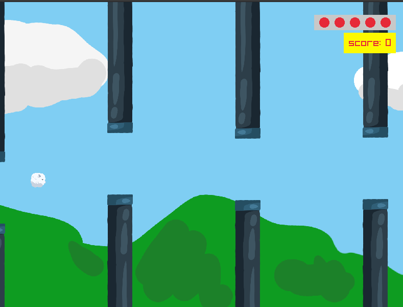

# Flappy Bnnuy
Built with [raylib](https://www.raylib.com/). Bootstraped with [the raylib quickstart](https://github.com/raylib-extras/raylib-quickstart).

AI was only used at the very end to review the code and fix some minor bugs, but the logic and architecture was solely devised By Me. I'm not a game dev, so the code is a mess.